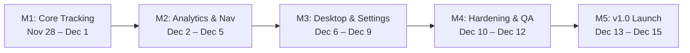

# 🍁 Maple — v1.0 Launch Roadmap

> **Desktop Habit & Metric Tracker** built with **Tauri v2 · React 19 · TypeScript · Tailwind CSS v4**
>
> | Timeline | Start Date | Launch Deadline | Remaining Window |
> | :--- | :--- | :--- | :--- |
> | **v1.0 Release Sprint** | Nov 28, 2026 | **Dec 15, 2026** | **17 Days** |

---

## 📋 Overview

Maple is currently in **beta**: the visual identity, 371-day heatmap grid, 8 custom color themes, tracker creation flow (Checkbox & Amount), and entry modal shell are in place. To ship a reliable, offline-ready **v1.0 desktop app by December 15**, the remaining work is organized into **5 date-boxed milestones**:

1. **Finish core entry & tracker mutations** so logging, editing, and deleting entries works cleanly for both tracker types.
2. **Replace hardcoded placeholders with live stats, search, filtering, and date-range switching.**
3. **Deliver the native Tauri desktop experience** (desktop-only pin-to-desktop widgets, Settings with JSON backup/restore, and offline font bundling).
4. **Harden code quality** (remove prototype/dead code, enable strict TypeScript checks, and test edge cases).
5. **Package, polish, and ship v1.0** with production bundle metadata, installers, and release documentation.

### Milestone Schedule

| # | Milestone | Target Dates | Primary Focus | Status |
| :-: | :--- | :--- | :--- | :--- |
| **M1** | [Core Tracking & Entry Engine](#milestone-1-core-tracking--entry-engine) | **Nov 28 – Dec 1** | Complete CRUD for Checkbox & Amount entries and trackers | 🟡 In Progress |
| **M2** | [Analytics, Search & Navigation](#milestone-2-analytics-search--navigation) | **Dec 2 – Dec 5** | Live streaks/stats, search, filter, reorder & date ranges | 🟡 In Progress |
| **M3** | [Desktop Experience & Settings](#milestone-3-desktop-experience--settings) | **Dec 6 – Dec 9** | Pinned sticky windows, Tauri detection, Settings & backups | 🟡 In Progress |
| **M4** | [Hardening, Cleanup & QA](#milestone-4-hardening-cleanup--qa) | **Dec 10 – Dec 12** | Strict TypeScript, dead code removal, lint & QA pass | ⚪ Planned |
| **M5** | [Packaging & v1.0 Launch](#milestone-5-packaging--v10-launch) | **Dec 13 – Dec 15** | Production identifiers, installers, README & v1.0 release | ⚪ Planned |

---

## Milestone 1: Core Tracking & Entry Engine
**📅 Target Dates: Nov 28 – Dec 1, 2026**
*Goal: Make creating, logging, editing, and deleting both Checkbox and Amount trackers completely bug-free.*

### Already Completed
- [x] Build `CreateTracker` page (`/create-habit`) with dynamic fields for `Checkbox` (`type: 0`) and `Amount` (`type: 1`) trackers
- [x] Add `createAt` timestamp and selected color theme (`themes.ts` — 8 themes) when creating a tracker
- [x] Implement 371-day calendar grid generation (`generateBinaryTrackerDays` & `generateAmountTrackerDays`) with weekday alignment (`returnExcludedDays`)
- [x] Render individual heatmap cells (`Square.tsx`) and open `AddEntryModal` on day click
- [x] Display conditional metric/amount input in `AddEntryModal` for Amount trackers, plus notes textarea and `Esc` key dismissal
- [x] Integrate tracker deletion (`handleDeleteTracker`) and `localStorage` persistence for tracker updates
- [x] Compute 4 intensity levels (`level1`–`level4` at 25% / 50% / 75% / 100% of max) and recalculate `blockColor` across days on save

### Remaining Tasks
- [ ] **Binary entry saving**: Set `checked: true` when saving a Checkbox entry in `AddEntryModal.tsx` (currently saving only persists notes without marking the day checked)
- [ ] **Binary entry removal**: Show a **Delete / Uncheck** button in `AddEntryModal.tsx` when opening a day that is already checked
- [ ] **Amount entry editing & removal**: Allow users to edit and re-save an existing amount entry or explicitly remove it from the modal
- [ ] **Zero-amount removal rule**: Treat setting an Amount entry to `0` (or clearing the field) as removing the entry and resetting its `blockColor` to `var(--color-bg)`
- [ ] **Fix `calculateBlockColor` for binary trackers**: Ensure saving a binary entry preserves/computes `blockColor` cleanly instead of overwriting it with `undefined`
- [ ] **Fix Amount math & input validation**:
  - [ ] Convert amount input to a validated `number` (reject negative/non-numeric input; avoid storing string values)
  - [ ] Fix `average` and `maximum` calculation in `AddEntryModal.tsx` so editing an existing day replaces its previous value instead of double-counting it in `daysWithAmount`
  - [ ] Fix `returnColorIntensity` in `src/constants/themes.ts` where `case 3` returns `theme.block4` instead of `theme.block3`
- [ ] **Wire up `Log today` button**: Connect the `Log today` button in `HeatMap.tsx` to open `AddEntryModal` pre-selected on today's day object
- [ ] **Validate Amount metric on creation**: Validate `newTracker.metric` when `type === 1` in `CreateTracker.tsx`, and fix the metric input `onFocus` handler (currently clears `errors.name` instead of `errors.metric`)
- [ ] **Tracker editing**: Allow users to edit an existing tracker's title, metric label, and color theme without recreating it
- [ ] **Delete confirmation**: Add a confirmation modal before deleting a tracker to prevent accidental data loss

---

## Milestone 2: Analytics, Search & Navigation
**📅 Target Dates: Dec 2 – Dec 5, 2026**
*Goal: Replace all placeholder data with real calculations and make every header, filter, and card control functional.*

### Already Completed
- [x] Create shared `RootLayout`, `Header`, `Footer`, and `NotFound` (`404`) pages
- [x] Design and style header logo (`MAPLe`), search bar UI, Create Tracker button, Trackerlist badge, and User menu button
- [x] Apply custom typography (`Anton`, `Nunito`, `Roboto Mono`), Rose Akashi highlight (`#ec003f`), custom scrollbars, and balanced lateral padding
- [x] Add expandable card drawer in `HeatMap.tsx` showing summary slots for Checkbox and Amount trackers
- [x] Add hover `ToolTip` component showing day status/amount and formatted date
- [x] Add date range dropdown UI (`Select.tsx`) with `12M` and current year options

### Remaining Tasks
- [ ] **Lift tracker state into a shared store/Context**: Sync tracker state reactively across `Header`, `Home`, `CreateTracker`, and `Settings` instead of reading `localStorage` independently per component
- [ ] **Fix Header tracker count**: Read from `'trackers'` instead of `'habits'` in `Header.tsx` and update live whenever trackers are added or deleted
- [ ] **Real Checkbox tracker analytics** (replace hardcoded values in `HeatMap.tsx`):
  - [ ] Compute real **Current Streak** (consecutive checked days up to today/yesterday)
  - [ ] Compute real **Longest Streak**
  - [ ] Compute real **Total entries** (and fix the card header count currently reading `tracker.entries?.length`)
- [ ] **Real Amount tracker analytics** (replace hardcoded `$10.00` / `$21.00` / `$3,231,000.000` in `HeatMap.tsx`):
  - [ ] Compute and display **Today's** logged amount with the tracker's actual metric
  - [ ] Compute real **Average** (across logged days), **Current Streak**, and **Total**
  - [ ] Format metrics cleanly in stats and `ToolTip.tsx` (handle prefixes like `$` vs units like `hours`/`miles` without broken pluralization like `$s`)
- [ ] **Functional Search & Type Filter**:
  - [ ] Wire the header search input to filter trackers on `Home` in real time
  - [ ] Wire the `All` filter dropdown (`All` / `Checkbox` / `Amount`) — currently clicking its arrow navigates to `/settings`
- [ ] **Tracker Reordering & Sorting**:
  - [ ] Add reorder controls (drag-and-drop or move up/down) and sort options (custom order, newest via `createAt`, alphabetical)
- [ ] **Functional Date Range Switching (`Select.tsx`)**:
  - [ ] Connect `Select.tsx` state to `HeatMap.tsx` to actually switch between rolling `12M` and full calendar year views
  - [ ] Handle multi-year data cleanly (so trackers don't break or lose history across year boundaries like 2026 → 2027)
- [ ] **UI & CSS bug fixes**:
  - [ ] Fix broken Tailwind classes in `HeatMap.tsx` (`w-[clamp(200px,90vw,1200px)]`), `AddEntryModal.tsx` (`rounded-md`, `-translate-y-5`), `CreateTracker.tsx` (stray `*:bg-`), and `Square.tsx` (`pointer-events-none` on binary tooltips + stray `group-hover:`)
  - [ ] Fix broken favicon path in `index.html` (`/logo2.svg` → `/logo-2.svg`)
  - [ ] Show a subtle indicator in `ToolTip` when a day has saved notes

---

## Milestone 3: Desktop Experience & Settings
**📅 Target Dates: Dec 6 – Dec 9, 2026**
*Goal: Deliver native Tauri desktop features (pinned tracker widgets, offline readiness) and a functional Settings page with data portability.*

### Already Completed
- [x] Initialize Tauri v2 desktop wrapper (`src-tauri/`) with logging plugin
- [x] Add `core:webview:allow-create-webview-window` permission in `src-tauri/capabilities/default.json`
- [x] Add "Pin to your desktop" button UI in `HeatMap.tsx`
- [x] Draft `createStickyWindow` helper in `src/components/StickWindow.ts`

### Remaining Tasks
- [ ] **Tauri runtime detection**: Detect whether Maple is running inside Tauri desktop (`isTauri()` from `@tauri-apps/api/core`) vs a web browser, and show the **Pin to desktop** button only in the desktop app
- [ ] **Complete Pinned Desktop Tracker Widget**:
  - [ ] Wire the pin button in `HeatMap.tsx` to `createStickyWindow(tracker.id)`
  - [ ] Add a dedicated widget route in `App.tsx` (e.g., `/map/:id` — `StickWindow.ts` currently opens `/map`, which hits `NotFound`)
  - [ ] Build a compact, borderless, draggable widget view (`data-tauri-drag-region`) showing the tracker heatmap/quick-log button and an unpin/close button
  - [ ] Sync entry changes live between pinned widget windows and the main window (via `storage` events or Tauri events)
  - [ ] Configure Tauri window capabilities so pinned windows can close, drag, and toggle `alwaysOnTop` cleanly
- [ ] **Build the `Settings` page (`src/pages/Settings.tsx`)**:
  - [ ] User display name setting (replace hardcoded `"yvy"` in `Header.tsx`)
  - [ ] **Export / Import Data (JSON)** so users can back up and restore all trackers safely
  - [ ] Default preferences (default theme for new trackers, confirmation toggle, reset/clear all data with confirmation)
- [ ] **Reliable desktop persistence**: Add schema versioning for stored tracker data and evaluate Tauri filesystem/store backup alongside `localStorage` so data survives WebView cache clears
- [ ] **Offline font bundling**: Self-host `Anton`, `Nunito`, and `Inter` in `public/fonts/` instead of importing from `fonts.googleapis.com` in `src/styles.css` so the desktop app renders identically offline
- [ ] **Window sizing & navigation polish**:
  - [ ] Update `src-tauri/tauri.conf.json` default window dimensions (currently `800x600`) and set sensible `minWidth` / `minHeight` so heatmaps don't clip
  - [ ] Fix `Footer.tsx` `/contact` and `/about` links (currently 404 — build an About/Version modal or wire valid links)

---

## Milestone 4: Hardening, Cleanup & QA
**📅 Target Dates: Dec 10 – Dec 12, 2026**
*Goal: Eliminate technical debt, enforce strict TypeScript safety, and verify every flow under edge cases.*

### Already Completed
- [x] Configure Biome (`biome.jsonc`) and Prettier (`prettier.config.js`) for linting and Tailwind class sorting
- [x] Set up TypeScript build pipeline (`tsc -b && vite build`)

### Remaining Tasks
- [ ] **Remove unused / prototype files and debug logs**:
  - [ ] Remove `src/pages/Prototype.tsx` and the `/proto-type` route from `App.tsx`
  - [ ] Remove dead components & drafts: `src/components/heat-map-old/HeathMapOld.tsx`, empty `src/components/heat-map/HeatMapBinary.tsx`, `src/components/Sidebar.tsx`, `src/components/Modal.tsx`, `src/utils/createHabit.ts` (contains syntax errors), `src/calculations/calculate_pallet.ts`, and `src/fake-data/data.json`
  - [ ] Strip leftover `console.log` statements across `Home.tsx`, `AddEntryModal.tsx`, `generateHabitDays.ts`, and `StickWindow.ts`
- [ ] **Strict TypeScript migration**:
  - [ ] Create centralized domain types (`src/types/tracker.ts`) for `Tracker`, `BinaryDay`, `AmountDay`, `TrackerType`, and `ThemeKey`
  - [ ] Enable all deferred compiler flags in `tsconfig.app.json`: `strictNullChecks`, `noImplicitAny`, `noUnusedLocals`, `noUnusedParameters`, and `verbatimModuleSyntax`
  - [ ] Replace all `any` props/handlers in `HeatMap.tsx`, `AddEntryModal.tsx`, `Square.tsx`, `ToolTip.tsx`, and `generateHabitDays.ts`
- [ ] **Lint & build verification**:
  - [ ] Run `pnpm check` (Biome) and resolve all lint/format warnings
  - [ ] Run `pnpm build` (`tsc -b && vite build`) cleanly with zero errors
- [ ] **Automated & Manual QA**:
  - [ ] Add unit tests for calendar generation (`generateHabitDays`), streak calculations, average/total formatting, and intensity level bucketing
  - [ ] Full manual QA pass: empty state, creating/editing/deleting both tracker types, logging/editing/clearing entries with notes, search/filter/reorder, pinning widgets, JSON export/import, offline launch, and app restart persistence

---

## Milestone 5: Packaging & v1.0 Launch
**📅 Target Dates: Dec 13 – Dec 15, 2026**
*Goal: Finalize production branding, build native desktop installers, and ship Maple v1.0 on December 15.*

### Already Completed
- [x] Configure Tauri bundle targets (`bundle.active: true`, `targets: "all"`) and initial icon assets in `src-tauri/icons/`
- [x] Create initial `README.md` and progress screenshots directory

### Remaining Tasks
- [ ] **Production app metadata & security**:
  - [ ] Update `src-tauri/tauri.conf.json`: replace placeholder `identifier` (`com.tauri.dev`) with production reverse-DNS identifier (e.g., `com.maple.app`), set `version` to `1.0.0`, and configure a strict Content Security Policy (`csp`)
  - [ ] Update `package.json` version (`0.0.0` → `1.0.0`) and `beforeDevCommand`/`beforeBuildCommand` in `tauri.conf.json` to match `pnpm`
  - [ ] Update `src-tauri/Cargo.toml` package `name`, `version`, `description`, `authors`, `license`, and `repository`
- [ ] **Final branding & icons**:
  - [ ] Regenerate all Tauri app icons (`pnpm tauri icon`) from the finalized Maple logo and verify crisp rendering in Linux/Windows/macOS launchers and taskbars
- [ ] **Build & test release artifacts (`pnpm tauri build`)**:
  - [ ] Build and test Linux bundles (`.AppImage`, `.deb`, `.rpm`) on a clean environment
  - [ ] Build and verify Windows / macOS installers (if targeting multi-platform at v1.0)
- [ ] **Documentation & Release Materials**:
  - [ ] Rewrite `README.md` with project overview, feature list, fresh v1.0 screenshots, download/install instructions, and local development steps
  - [ ] Archive or clean up scratch files (`plan.raw`, `todo.todo`) before tagging
  - [ ] Write `v1.0.0` changelog / release notes
- [ ] **🚀 Dec 15 Launch Day**:
  - [ ] Final fresh-install smoke test using the built v1.0 installer
  - [ ] Tag `v1.0.0` in Git and publish the release artifacts

---

*Last updated: November 28, 2026*
